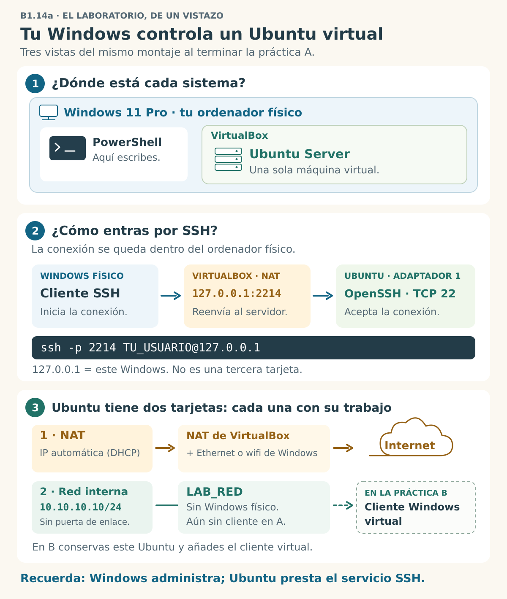

## B1.14a — Ubuntu Server y SSH desde Windows físico

> [!abstract] Ficha de la práctica
> ### 📌 `B1.14a` — Ubuntu Server y SSH desde Windows físico
> - **Bloque 1** (Preparar el entorno) · **Nivel 2** (Intermedio) · **RA.01** · **CE.01.i**
> - **🎬 Playlist:** `B1_Entorno`
> - **📹 Nombre del vídeo:** `B1.14a · Ubuntu Server y SSH desde Windows físico`

> [!info] Caso real
> Un técnico puede administrar un servidor sin usar su pantalla: abre una terminal en su puesto y entra por SSH. Aquí tu puesto es el **Windows físico** y el servidor es **una sola VM Ubuntu Server**. Después añadirás clientes virtuales sin reinstalar el servidor.

- **🎯 Objetivo real:** instalar `B1-UbuntuServer`, preparar NAT y `LAB_RED`, fijar `10.10.10.10/24` y entrar por SSH desde el Windows físico.
- **🧩 Problema que resuelve:** empezar con una VM, comprobar la administración remota y conservar el servidor para **B1.14b** y **B1.14c**.

> [!danger] Antes de empezar en un equipo gestionado
> VirtualBox debe estar instalado y poder ejecutar VM. Necesitas una ubicación donde puedas guardar la VM, recursos disponibles según B1.9, una ISO de Ubuntu Server verificada en B1.4 y un **cliente SSH ya disponible en Windows**. La cuenta de Ubuntu debe poder usar `sudo`.
> En Windows usarás **PowerShell normal, sin elevar**. No instales componentes, cambies políticas, modifiques adaptadores físicos ni desactives el cortafuegos. Si `ssh` está ausente o bloqueado, la configuración exige permisos que no tienes o una política bloquea la conexión, **detente y consulta al profesor**. No intentes eludir la gestión del equipo.

## 📚 Fundamento



*Lee la imagen de arriba abajo: **1**, dónde está cada sistema; **2**, cómo entras por SSH; **3**, para qué sirve cada tarjeta. Son tres vistas del **mismo laboratorio al terminar A**. El cliente virtual del recuadro discontinuo se añadirá en B.*

> [!info] Dos caminos para el mismo servidor
> Piensa en una oficina con una puerta de servicio y una mesa de trabajo: puedes entrar para administrar sin ocupar el puesto que más tarde usarás para probar los clientes.
>
> | Elemento | Configuración | Función |
> | :--- | :--- | :--- |
> | Windows físico | Cliente `ssh` | Terminal desde la que administras Ubuntu |
> | Adaptador 1 de la VM | NAT, dirección automática | Internet y entrada SSH mediante redirección |
> | Regla NAT de la VM | TCP `127.0.0.1:2214` → invitado `:22` | Une el cliente local con OpenSSH de Ubuntu |
> | Adaptador 2 de la VM | Red interna `LAB_RED`, `10.10.10.10/24` | Preparado para los clientes de B1.14b y B1.14c |
>
> **La regla se guarda en VirtualBox.** No cambia la IP, el DNS ni los ficheros de sistema de Windows. El cliente SSH guardará la huella aceptada en su registro de servidores conocidos dentro de tu perfil de usuario.
> La red interna no incluye al anfitrión. Por eso **no conectarás Windows físico a `10.10.10.10`**: entrarás por `127.0.0.1` y el puerto `2214`. Es una conexión remota al sistema invitado, aunque ambos sistemas estén en el mismo ordenador.
> B1.14b añadirá el cliente Windows virtual a `LAB_RED`. **No quitarás la regla SSH, ni cambiarás las tarjetas o la IP del servidor.**

> [!warning] El fallo nº1: confundir dónde se ejecuta el comando
> Antes de conectar estás en Windows. Después de conectar por SSH, esa misma ventana ejecuta comandos en Ubuntu. **`exit` cierra la sesión remota y vuelve a Windows.** No ejecutes comandos Linux en PowerShell local ni cambies la red del Windows físico para alcanzar la VM.

> [!example] Vocabulario
> - **Anfitrión:** el Windows físico que ejecuta VirtualBox.
> - **Invitado:** Ubuntu Server dentro de la VM.
> - **Cliente SSH:** programa que inicia la conexión; aquí está en Windows.
> - **OpenSSH Server:** programa de Ubuntu que acepta la conexión en el puerto TCP `22`.
> - **Loopback (`127.0.0.1`):** «este mismo ordenador»; en el comando local se refiere a Windows.
> - **Redirección NAT:** VirtualBox recibe la conexión en el puerto local `2214` y la entrega al `22` del invitado.
> - **Huella de servidor:** identificador de su clave pública; lo comparas en la consola antes de aceptar la primera conexión. No es el hash de la ISO ni tu contraseña.
> - **Netplan:** configuración de red de Ubuntu Server mediante YAML. `/24` equivale a `255.255.255.0`.

> [!example] Comandos que vas a usar
> | Dónde | Comando | Para qué |
> | :--- | :--- | :--- |
> | Windows | `ssh -V` | Comprobar el cliente instalado |
> | Windows | `Get-NetTCPConnection` | Consultar si hay una escucha en el puerto local elegido |
> | Windows | `ssh -p 2214 TU_USUARIO@127.0.0.1` | Entrar en Ubuntu mediante VirtualBox |
> | Ubuntu | `ip -br a` · `ip link` | Ver direcciones, estado y MAC |
> | Ubuntu | `sudo netplan try` | Probar la IP fija y confirmarla |
> | Ubuntu | `sudo apt install openssh-server` | Instalar o confirmar el paquete SSH |
> | Ubuntu | `sudo ss -ltnp` | Consultar puertos TCP en escucha |
> | Ubuntu | `sudo ssh-keygen -lf /etc/ssh/ssh_host_ed25519_key.pub` | Mostrar la huella pública del servidor |
> | Ubuntu | `exit` | Cerrar la sesión remota |

## 📹 Grabación de esta práctica

> [!important] Obligaciones de grabación
> 1. Lee la práctica completa y crea la entrada vacía `b1-14a-ubuntu-server-y-ssh-desde-windows-fisico.md` en `00_Apuntes/Trimestre_N/B1_Entorno/`, con la estructura del **Bloque 0 · Fase 0.1.b**.
> 2. Arranca OBS y preséntate mostrando tu identidad (Teams o correo del centro). No muestres ni dictes contraseñas.
> 3. Añade timestamps reales: `00:00 Presentación`, uno por paso y las marcas de inicio y fin de la instalación.
> 4. Sube el vídeo **`B1.14a · Ubuntu Server y SSH desde Windows físico`** a **`B1_Entorno`**, como **No listado**, y enlázalo desde los apuntes.
> 5. Se graba una sola vez, sin duplicarlo entre casa y centro. Entregarás el enlace a tu repositorio de apuntes en la tarea de Teams que indique el profesor; el vídeo queda enlazado dentro de la entrada.

> [!tip] Marcas para localizar las evidencias
> ```
> 00:00 Presentación
> Paso 0 · Cliente SSH, puerto libre y hash de Ubuntu
> Paso 1 · VM y sus dos adaptadores
> Paso 2 · Instalación de Ubuntu (inicio)
> Paso 2 · Instalación de Ubuntu (fin)
> Paso 3 · Identificación por MAC
> Paso 4 · IP fija con netplan
> Paso 5 · OpenSSH y escucha en el puerto 22
> Paso 6 · Redirección NAT limitada a loopback
> Paso 7 · Huella y primera conexión SSH
> Paso 8 · Comprobar en qué equipo estás y salir
> Paso 9 · Reinicio y conexión conservada
> Paso 10 · Instantánea, apuntes y cierre
> ```
> Sustituye cada etiqueta por su minuto real; no copies tiempos de otra persona.

## 🛠️ Procedimiento

> [!example] Paso 0 — Prepara la entrada, graba y comprueba el Windows físico
> Crea la entrada vacía, arranca OBS y preséntate. En **PowerShell normal del Windows físico**, comprueba primero el cliente:
> ```powershell
> ssh -V
> ```
> - `ssh` ejecuta el cliente; `-V` muestra su versión, sin conectarse.
> - Debe mostrar una versión de OpenSSH. Si no reconoce el comando o aparece un bloqueo, **para y consulta**; no instales nada con permisos ajenos.
>
> Antes de asignar el puerto `2214`, consulta si ya tiene una escucha:
> ```powershell
> Get-NetTCPConnection -State Listen | Where-Object LocalPort -eq 2214
> ```
> - `Get-NetTCPConnection -State Listen` consulta las escuchas TCP; la tubería `|` pasa las filas a `Where-Object`, que conserva solo las de `LocalPort` igual a `2214` (`-eq`). Los errores de consulta se muestran: no se ocultan.
> - Si aparecen filas, el puerto está ocupado: **detente**. Si la consulta no se puede ejecutar por restricciones, consulta al profesor. Sin filas no se ha encontrado una escucha, pero todavía tendrás que probar que VirtualBox puede usarlo.
> - Se usa `2214` para distinguir esta práctica de los puertos `2222` y `2223` del laboratorio de Shell. No cambies las reglas de otras VM.
>
> Ten la ISO de **Ubuntu Server 26.04 LTS** y verifica su SHA-256 como en **B1.4**: hash oficial de esa descarga, hash calculado y comparación con `-eq`. Guarda los valores y el resultado en los apuntes. **Si no da `True`, no crees la VM**: descarga de nuevo y repite la comprobación. La virtualización y los recursos del anfitrión deben haberse comprobado en B1.9.

> [!example] Paso 1 — Crea la VM del servidor: Ubuntu Server
> Crea la VM `B1-UbuntuServer` como ya sabes (B1.9 y B1.10): tipo **Linux · Ubuntu (64-bit)**, **2 CPU, 2048 MB de RAM, disco de 25 GB**, con la ISO de Ubuntu Server 26.04.
>
> **Desactiva la instalación desatendida.** El asistente de VirtualBox la activa por defecto cuando le das una ISO que la admite. Según tu versión, la casilla dice que **te saltes** la instalación desatendida (márcala) o que **instales con** instalación desatendida (desmárcala). El resultado tiene que ser el mismo: la instalación la haces tú.
>
> **Antes de arrancarla**, ve a **Configuración → Red**. *Si no ves el Adaptador 2 o la parte de opciones avanzadas, VirtualBox está en el nivel de experiencia **Básico**, que oculta ajustes: cámbialo a **Experto** en la propia ventana de configuración.*
> - **Adaptador 1:** déjalo como está → **NAT**.
> - **Adaptador 2:** marca **Habilitar adaptador de red** → **Conectado a: Red interna** → **Nombre:** escribe `LAB_RED`.
>
> **Por qué escribes el nombre a mano y con cuidado:** dos VM solo están en la misma red interna si el nombre es **exactamente el mismo**. `LAB_RED` y `lab_red` son dos redes distintas, y no te avisará nadie.
>
> Despliega **Avanzadas** en el adaptador 2, comprueba que **Cable conectado** está marcado y **apunta su dirección MAC**. Te servirá para reconocer la tarjeta dentro de Ubuntu.

> [!example] Paso 2 — Instala Ubuntu Server
> Instálalo con las opciones por defecto. En la pantalla de red verás dos tarjetas:
> - Una (la del NAT) recibe sola una IP `10.0.2.15`.
> - La otra (la de `LAB_RED`) se queda **sin dirección**: el instalador intenta pedir una por DHCP y en esa red no contesta nadie.
>
> **Déjala así.** La configuras después, y a mano. En la pantalla de SSH selecciona **Install OpenSSH server** y permite inicialmente la autenticación por contraseña si el instalador lo pregunta. Usa una cuenta propia de Ubuntu con contraseña; anota su nombre, pero no escribas ni grabes la contraseña. No importes claves de GitHub para esta práctica.
>
> Puede que el primer arranque del sistema instalado tarde un poco más de lo normal en la red: Ubuntu espera un rato a esa tarjeta que pide IP y no la consigue. En el Paso 4 lo arreglas.

> [!example] Paso 3 — Identifica la tarjeta del laboratorio
> Entra en el servidor y ejecuta:
> ```bash
> ip -br a
> ip link
> ```
> Con `ip -br a` ves las tarjetas: una con `10.0.2.15` y otra **sin IPv4**. Con `ip link` compruebas que la MAC de esa tarjeta sin IP coincide con la que apuntaste en el Paso 1. Ojo al formato: VirtualBox la enseña seguida (`080027…`) y Linux con dos puntos (`08:00:27:…`). **Esa es la tuya.**
>
> Lo normal es que se llame `enp0s8`, y así aparece en el resto de la práctica. **Si a ti te sale otro nombre, usa el tuyo en todos los comandos.** No copies un nombre de tarjeta de un tutorial: se mira.

> [!example] Paso 4 — Dale IP fija con netplan
> **Primero, mira lo que dejó el instalador:**
> ```bash
> ls /etc/netplan/
> sudo cat /etc/netplan/*.yaml
> ```
> Verás un fichero que escribió el instalador. Su nombre depende de la versión y de cómo se instaló (por ejemplo `00-installer-config.yaml` o `50-cloud-init.yaml`). **Fíjate en si aparece tu tarjeta del laboratorio con `dhcp4: true`.** Lo normal es que sí: el instalador la dejó pidiendo IP por DHCP, aunque nadie le contestara.
>
> **Ahora crea un fichero nuevo**, solo para el laboratorio:
> ```bash
> sudo nano /etc/netplan/60-laboratorio.yaml
> ```
> Escribe esto, **con espacios y nunca con tabuladores**:
> ```yaml
> network:
>   version: 2
>   ethernets:
>     enp0s8:
>       dhcp4: false
>       addresses:
>         - 10.10.10.10/24
> ```
> **Por qué un fichero nuevo y no editar el del instalador:** netplan lee **todos** los ficheros de `/etc/netplan/` en orden alfabético, y **lo que dice un fichero posterior pisa lo que decía uno anterior** para la misma opción. Tu `60-…` va detrás del `00-…` y del `50-…`, así que manda él. Y tu cambio queda entero en un fichero tuyo: si algo va mal, sabes exactamente qué tocaste.
>
> **Por qué `dhcp4: false`:** si el fichero del instalador dice `dhcp4: true` para esta tarjeta y tú no lo desmientes, la tarjeta seguiría pidiendo IP por DHCP a una red donde nadie reparte, y el arranque seguiría esperándola. Con `false` en tu fichero, el valor del instalador queda pisado.
>
> **Por qué no pones puerta de enlace (`gateway`, `routes`):** la salida a Internet ya la da el NAT. Si le pones otra puerta de enlace a esta tarjeta, el servidor tiene dos caminos para salir a Internet y uno no lleva a ningún sitio: **puedes perder Internet**.
>
> Protege el fichero y prueba la configuración:
> ```bash
> sudo chmod 600 /etc/netplan/60-laboratorio.yaml
> sudo netplan try
> ```
> **Por qué `chmod 600`:** netplan recomienda que sus ficheros solo los pueda leer `root`, porque a veces guardan contraseñas de wifi o claves de VPN. Si lo dejas abierto, te lo recordará con un aviso cada vez.
>
> **Por qué `try` y no `apply`:** `try` aplica la configuración y te pide que pulses **Intro** para confirmarla. Si no la confirmas en **120 segundos** (por ejemplo, porque te has quedado sin red), la deshace sola. Si todo va bien, pulsa **Intro**.
>
> Comprueba:
> ```bash
> ip -br a
> ```
> La tarjeta `enp0s8` tiene que aparecer **UP** con `10.10.10.10/24`.

> [!example] Paso 5 — Prepara OpenSSH en la consola de Ubuntu
> Aquí sigues dentro de la **consola de la VM**, con tu cuenta de Ubuntu. Actualiza el índice de paquetes e instala o confirma el paquete del servidor:
> ```bash
> sudo apt update
> sudo apt install openssh-server
> ```
> - `sudo apt update` actualiza el catálogo desde los repositorios; no actualiza todos los programas.
> - `sudo apt install openssh-server` instala el servidor y sus dependencias, o indica que ya está instalado. Confirma la instalación cuando lo pida.
> - Ambos comandos deben terminar sin errores. Si la red del centro impide acceder a los repositorios, **para y consulta**; no cambies el proxy o el DNS del Windows físico.
>
> Consulta la configuración efectiva y la escucha:
> ```bash
> sudo sshd -t
> sudo sshd -T
> sudo ss -ltnp
> sudo ufw status
> ```
> - `sshd -t` comprueba la sintaxis de configuración y las claves: sin mensajes indica que no detecta errores de esa comprobación.
> - `sshd -T` muestra los ajustes efectivos. Busca `port 22`, `passwordauthentication yes` y `hostkey /etc/ssh/ssh_host_ed25519_key`; si no coinciden, **consulta antes de editar ficheros**.
> - `ss -ltnp`: `-l` escucha, `-t` TCP, `-n` números sin resolver nombres y `-p` proceso. Debe verse el puerto `22` escuchando en una dirección que admita el adaptador NAT, no únicamente en `127.0.0.1` dentro de Ubuntu. Puede figurar `sshd` o una escucha gestionada por `systemd`.
> - `ufw status` consulta el cortafuegos. Si está inactivo, no lo actives para esta práctica. Si está activo, **no lo desactives**: consulta al profesor para revisar el permiso de SSH.
>
> Si el paquete está instalado, la configuración pasa la prueba y falta la escucha, inicia el servicio:
> ```bash
> sudo systemctl start ssh.service
> sudo ss -ltnp
> ```
> - `systemctl start ssh.service` intenta iniciar OpenSSH ahora; no cambia sus opciones de autenticación.
> - Repite la consulta de escucha y busca el `22`. Si hay errores, **detente**. En Ubuntu también puede intervenir `ssh.socket`: no lo desactives ni cambies unidades a ciegas. El reinicio del Paso 9 comprobará la disponibilidad al arrancar.
>
> **No necesitas modificar `/etc/ssh/sshd_config` si estos controles y la conexión funcionan.** Tampoco se habilita el acceso como `root`: entrarás con tu cuenta normal y usarás `sudo` dentro de Ubuntu cuando haga falta.

> [!example] Paso 6 — Configura la redirección en VirtualBox
> Apaga Ubuntu ordenadamente desde su consola:
> ```bash
> sudo poweroff
> ```
> `sudo poweroff` apaga el invitado. Espera a que VirtualBox lo muestre **Apagada** antes de cambiar su configuración.
>
> Selecciona `B1-UbuntuServer` y abre **Configuración → Red → Adaptador 1**, en **NAT**. En **Avanzadas → Reenvío de puertos** añade la regla siguiente. Si tu versión oculta estos ajustes, usa el nivel de experiencia **Experto**, como en el Paso 1; si las etiquetas no coinciden, consulta antes de guardar.
>
> | Campo | Valor | Por qué |
> | :--- | :--- | :--- |
> | Nombre | `ssh-b1-14a` | Identifica esta regla |
> | Protocolo | `TCP` | Transporte de SSH |
> | IP anfitrión | `127.0.0.1` | Solo escucha desde el propio Windows |
> | Puerto anfitrión | `2214` | Puerto local reservado para esta práctica |
> | IP invitado | **Vacía** | La tarjeta NAT recibe su IP por el DHCP de VirtualBox |
> | Puerto invitado | `22` | Puerto del servidor OpenSSH |
>
> **No dejes vacía la IP anfitrión**: ampliarías la escucha a otras interfaces. No pongas `10.10.10.10` en «IP invitado»: esa es la otra tarjeta, la de `LAB_RED`. No alteres el adaptador 2 ni otras VM. Revisa la fila, guarda y arranca el servidor.
> Si VirtualBox no puede usar el puerto o Windows pide permisos para cambiar seguridad, **detente y consulta**; no amplíes permisos ni desactives el firewall.

> [!example] Paso 7 — Compara la huella y conecta desde Windows
> Primero, **en la consola de Ubuntu**, muestra la huella de su clave pública ED25519:
> ```bash
> sudo ssh-keygen -lf /etc/ssh/ssh_host_ed25519_key.pub
> ```
> `ssh-keygen` consulta la clave; `-l` muestra su huella y `-f` el fichero elegido. Anota la cadena `SHA256:` y el tipo `ED25519`. Es una clave **pública del servidor**, no la clave privada ni tu contraseña.
>
> Vuelve a **PowerShell normal del Windows físico**. Sustituye `TU_USUARIO` por el nombre real de la cuenta que creaste al instalar Ubuntu, antes de ejecutar:
> ```powershell
> ssh -p 2214 TU_USUARIO@127.0.0.1
> ```
> - `ssh` inicia el cliente, `-p 2214` selecciona el puerto local, `TU_USUARIO` identifica tu cuenta de Ubuntu y `127.0.0.1` apunta al Windows físico. VirtualBox lleva la conexión al servidor.
> - En el primer acceso compara la huella que pregunta el cliente con la obtenida en la consola. **Solo si coincide y dice ED25519**, acepta con `yes`. Si es diferente, aparece un aviso de clave cambiada o el tipo es otro, **no aceptes ni borres el registro de claves**: consulta al profesor.
> - Introduce la contraseña de Ubuntu sin mostrarla. La terminal no dibuja caracteres mientras escribes. Debes obtener una shell de Ubuntu. Si la autenticación falla, no edites ficheros de SSH por ensayo y error.

> [!example] Paso 8 — Demuestra dónde estás y vuelve al anfitrión
> Dentro de la sesión **SSH de Ubuntu**, identifica usuario, equipo, directorio y red:
> ```bash
> whoami
> hostname
> pwd
> ip -br a
> ```
> - `whoami` muestra tu usuario de Ubuntu.
> - `hostname` muestra el nombre del servidor que anotaste al instalarlo.
> - `pwd` muestra el directorio actual en Ubuntu.
> - `ip -br a` debe conservar NAT y la tarjeta de `LAB_RED` con `10.10.10.10/24`.
>
> Cierra esa sesión remota:
> ```bash
> exit
> ```
> `exit` devuelve la ventana a PowerShell local. Comprueba ahora el nombre del Windows físico:
> ```powershell
> hostname
> ```
> `hostname` se ejecuta ahora en Windows: su resultado debe identificar al anfitrión, no al servidor. Registra ambos nombres; no basta con que «se abra una terminal».

> [!example] Paso 9 — Comprueba que todo sobrevive al reinicio
> En la **consola de Ubuntu**, reinicia el servidor:
> ```bash
> sudo reboot
> ```
> `sudo reboot` reinicia el invitado. Espera a su arranque y repite desde Windows físico el acceso del Paso 7, con tu usuario real:
> ```powershell
> ssh -p 2214 TU_USUARIO@127.0.0.1
> ```
> Debe conectar sin una huella inesperada. Dentro de Ubuntu, comprueba de nuevo la IP fija y la salida a Internet:
> ```bash
> ip -br a
> sudo apt update
> ```
> - `ip -br a` debe conservar `10.10.10.10/24` en la tarjeta real de `LAB_RED`.
> - `apt update` debe acceder a los repositorios sin errores: comprueba Internet y DNS desde Ubuntu.
> - Si falla el acceso tras reiniciar, revisa la escucha desde la consola como en el Paso 5 y consulta al profesor. **No cierres como completada una práctica que solo funcionó antes del reinicio.**

> [!example] Paso 10 — Conserva el servidor y cierra
> Desde Ubuntu, termina apagando el invitado:
> ```bash
> sudo poweroff
> ```
> `sudo poweroff` apaga Ubuntu; si lo ejecutas dentro de SSH, la conexión se cerrará. No apaga el Windows físico.
> Con la VM apagada, crea una instantánea en VirtualBox llamada **`B1.14a · Servidor SSH OK`**. Conserva la misma VM `B1-UbuntuServer`, sus dos adaptadores, la IP fija y la regla `ssh-b1-14a` para B1.14b. **No exportes, borres, clones ni reinstales el servidor para continuar.**
> Detén OBS, sube el vídeo con el nombre indicado y sus timestamps reales, y pega su enlace en tus apuntes. Completa las respuestas y guarda la entrada en tu repositorio mediante el circuito Git aprendido en el Bloque 0.

## 🚩 Errores y verificación

> [!warning] Errores típicos
> | Error | Qué pasa | Cómo actuar |
> | :--- | :--- | :--- |
> | `ssh` ausente o bloqueado en Windows | No hay cliente utilizable | Parar y consultar; no instalar ni cambiar políticas del equipo |
> | Puerto `2214` ocupado o reservado | VirtualBox no puede establecer la escucha | No cambiar otras reglas; consultar al profesor |
> | SSH a `10.10.10.10` desde Windows físico | No accede a la red interna | Usar `127.0.0.1` y el puerto `2214` |
> | `Connection refused` | No hay servicio accesible en ese destino | Revisar VM encendida, regla NAT y escucha `22` desde la consola |
> | Tiempo de espera | No se completa la conexión | Revisar regla y políticas con el profesor; no desactivar cortafuegos |
> | `Permission denied` | Falló la autenticación | Comprobar usuario y acceso por consola; no habilitar `root` ni cambiar opciones sin diagnóstico |
> | Huella distinta o clave cambiada | No se ha confirmado la identidad del servidor | Parar y comparar en la consola; no aceptar ni borrar claves a ciegas |
> | IP anfitrión vacía en la regla | Escucha más amplia que el propio ordenador | Antes de arrancar, fijar `127.0.0.1` |
> | Se modifica el NAT en vez de la tarjeta interna | Se puede perder Internet o la redirección | Identificar tarjetas por MAC, como en los pasos 1 y 3 |
> | YAML inválido | Netplan rechaza la configuración | Espacios, nombre real de interfaz y `netplan try` antes de confirmar |

> [!success] Comprueba antes de guardar
> - Hash oficial y calculado de Ubuntu coinciden, con `True` anotado antes de crear la VM.
> - Solo se ha creado una VM: `B1-UbuntuServer`.
> - Adaptador 1 NAT con IP automática; adaptador 2 `LAB_RED`, `10.10.10.10/24`, sin puerta de enlace propia.
> - Regla TCP `127.0.0.1:2214` → puerto `22` del invitado, sin cambiar la red física de Windows.
> - Huella ED25519 contrastada con la consola.
> - SSH entra con tu usuario normal; `whoami`, `hostname` y `pwd` demuestran que estás en Ubuntu; `exit` vuelve a Windows.
> - Tras reiniciar, SSH funciona, la IP fija persiste e Internet funciona en Ubuntu.
> - Instantánea `B1.14a · Servidor SSH OK`, vídeo con timestamps y entrada de apuntes completa.

> [!question] Comprueba que lo has entendido
> 1. ¿Qué sistema ejecuta `ssh` antes de conectar y cuál ejecuta `whoami` después? ¿Qué cambia al hacer `exit`?
> 2. ¿Por qué Windows físico entra por `127.0.0.1:2214` y no por `10.10.10.10`? Explica el recorrido hasta el puerto `22`.
> 3. ¿Por qué dejas vacía la IP invitado y escribes `127.0.0.1` en la IP anfitrión? ¿Qué tarjeta usa cada camino?
> 4. ¿Qué identifica la huella de servidor y en qué se diferencia del hash de la ISO?
> 5. ¿Por qué la tarjeta interna tiene IP fija y no lleva puerta de enlace?
> 6. ¿Qué conservarás para B1.14b? ¿Por qué no hay que deshacer la regla SSH?

## ✅ Entregables y cierre

- **Entregable técnico:** `B1-UbuntuServer` con NAT, `LAB_RED`, `10.10.10.10/24`, SSH probado desde Windows físico y la instantánea `B1.14a · Servidor SSH OK`.
- **Vídeo:** `B1.14a · Ubuntu Server y SSH desde Windows físico`, en `B1_Entorno`, No listado, con presentación, instalación y timestamps reales.
- **Apuntes:** `b1-14a-ubuntu-server-y-ssh-desde-windows-fisico.md`, con la estructura del Bloque 0, hashes, resultados, errores, respuestas y enlace al vídeo. No incluyas contraseñas ni claves privadas.
- **Criterio de éxito:** acceso real por SSH también tras reiniciar, con la identidad contrastada y el servidor preparado para recibir un cliente virtual.
- **Entrega:** enlace al repositorio de apuntes en la tarea de Teams indicada por el profesor; se realiza una sola vez.

> [!danger] La instantánea no entrega tus apuntes ni tu vídeo
> La instantánea conserva un punto del estado de la VM. El vídeo y los apuntes deben estar publicados por sus respectivos circuitos. Las preguntas se contestan con tus palabras en la entrada; dejarlas en blanco deja incompleta la práctica.

> [!summary] Qué has aprendido
> Has preparado un servidor, separado Internet de la red interna y demostrado desde qué sistema ejecutas cada comando al entrar y salir por SSH. El Windows físico actúa como cliente sin cambiar su red.
> **Siguiente:** [B1.14b — Añadir el cliente Windows 11 virtual](B1_14.b_Red_VirtualBox_Windows_11_y_Ubuntu_Server.md), reutilizando el servidor tal como está.

## Fuentes técnicas

- [Oracle VirtualBox 7.2 · Redes y redirección NAT](https://docs.oracle.com/en/virtualization/virtualbox/7.2/user/networkingdetails.html).
- [Ubuntu Server · OpenSSH](https://ubuntu.com/server/docs/how-to/security/openssh-server/).
- [Microsoft · OpenSSH en Windows](https://learn.microsoft.com/en-us/windows-server/administration/openssh/openssh_install_firstuse).
